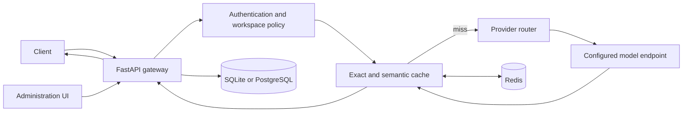

# AI Semantic Cache Gateway

A self-hosted API gateway that checks exact and semantically similar response caches before routing requests to configured language-model providers.

## Main functions

- OpenAI-compatible chat and responses API routes.
- Exact-response caching and embedding-based semantic lookup backed by Redis.
- Configurable similarity cutoff: it controls the minimum match score for reusing a cached answer, balancing cache reuse against accepting a less relevant match.
- Provider configuration and routing, request history, cache metrics, workspace settings, and an administration interface.
- SQLite for local development, with optional PostgreSQL configuration.

## Technology

Python 3.11, FastAPI, Redis, Sentence Transformers, PostgreSQL/SQLite, JavaScript, and CSS. The provider layer supports OpenAI-compatible endpoints and configured provider adapters.

## Request flow



## Local setup

Use Python 3.11 and a running Redis instance. From the repository root:

```powershell
Copy-Item config/.env.example config/.env
py -3.11 -m venv .venv
.\.venv\Scripts\Activate.ps1
python -m pip install -r requirements.txt
python -m uvicorn app.api.server:app --host 127.0.0.1 --port 8000
```

Open `http://127.0.0.1:8000` for the administration UI. Configure provider credentials only in the ignored `config/.env` file. Keep real keys and local databases out of Git. The embedding model may download on first use; the Docker image pins its model revision.

## Scope

Cache behavior depends on the model, threshold, provider, and request workload. No latency, cost, or cache-hit improvement is claimed here. Provider requests and Redis-backed cache features require their corresponding configuration.
